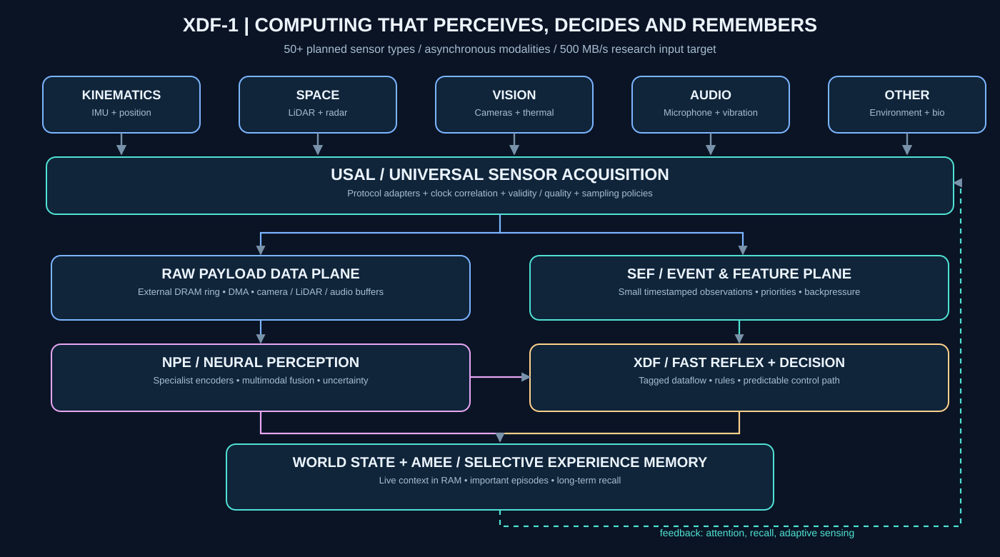
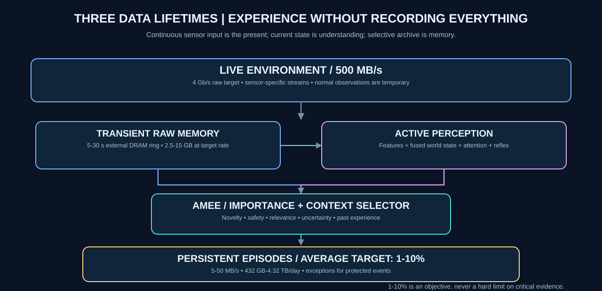
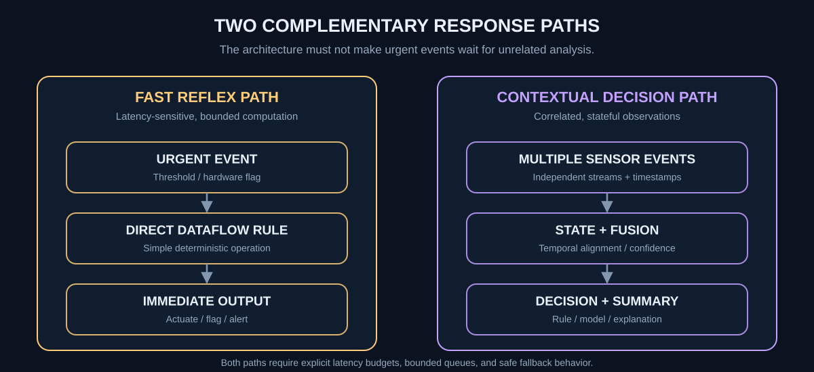
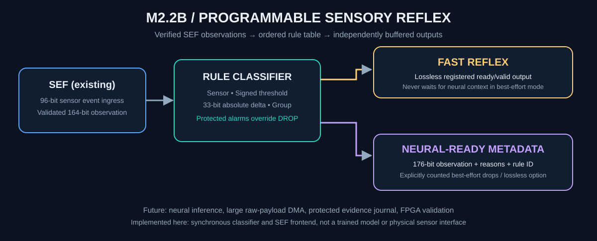
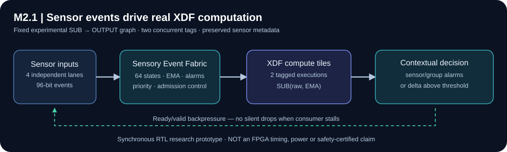
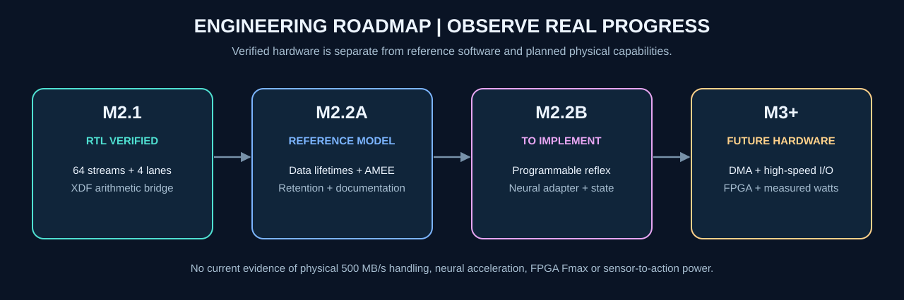

# XDF-1 — A Processor That Perceives, Decides and Remembers

**Experimental event-driven sensory computing architecture.**

**XDF-1 is not intended to be another general-purpose CPU.** Its long-term purpose is to continuously perceive the physical world through many different sensors, recognize meaningful changes, combine observations, react with low latency, maintain a useful representation of the present, and selectively preserve important experiences for future decisions.

The central research question is whether **tagged-token dataflow computing**, combined with specialized neural perception and an autonomous memory hierarchy, can provide a programmable and efficient alternative for selected real-time sensory workloads. We will **measure**, rather than assume, advantages over CPUs, GPUs and existing FPGA solutions.



> **Design philosophy:** **Sense everything useful. Understand continuously. React when necessary. Remember what matters. Learn only through validated adaptation.**

The *brain* comparison is functional: raw sensory input is the **present**, compact working state is an ongoing **interpretation**, and experience memory is **selected past information**. We make **no claim of consciousness or biological equivalence**.

## Raw perception is not the same thing as memory

A sensor processor should not store the entire environment simply because the data arrived. Incoming information is processed in the moment; features and working context are updated; most raw buffers can expire. When a meaningful situation occurs, XDF-1 should preserve a meaningful event record and, when justified, the sensor data **before and after** the event. Previously stored experiences should later be retrievable as context.



| Information lifetime | What it represents | Planned location |
| --- | --- | --- |
| **Live sensory input** | Original camera frames, point clouds, radio measurements, audio and sensor samples | High-speed acquisition with bounded external DRAM ring |
| **Working world state** | Current objects, motion, features, measurements, confidence, uncertainty and active context | Small on-chip state + external RAM |
| **Episodic memory (AMEE)** | Significant experiences, decisions, model explanations, linked evidence and optional raw clips | Indexed, encrypted nonvolatile storage |

**A future Neural Perception Engine (NPE)** will use modality-specific feature encoders and time-aware fusion, rather than forcing all raw data through one large universal model. **A fast-reflex path must not wait on neural inference or disk I/O.** Safety-critical applications must use separately validated protections.

## The 500 MB/s goal, in actual engineering units

We target the ability to **accept at least 500 megabytes per second of heterogeneous raw sensor payload**. This is a proposed system-level requirement, **not** achieved by the current RTL. The raw payload must use a separate high-bandwidth path; the existing small 96-bit sensory-event tokens are not video-frame transport.

| Proposed operating target | Decimal units |
| --- | ---: |
| Aggregate raw sensor input | **500 MB/s = 4 Gb/s** before transport overhead |
| Raw data produced in an hour / day | 1.8 TB / 43.2 TB |
| 5–30-second raw-data window | **2.5–15 GB of external DRAM** |
| **1%** raw-volume equivalent selected for storage | 5 MB/s; 432 GB/day |
| **10%** raw-volume equivalent selected for storage | 50 MB/s; 4.32 TB/day |

**The 1–10% long-term retention goal is an *average storage budget*, not a hard cutoff or a demonstrated reduction.** Protected events can exceed it; important raw evidence must not disappear because a neural model produces a low score. We will evaluate retention against missed-event rates, quality of recollection, downstream decision accuracy and disk endurance. A disk archive can store summaries, feature vectors, optional raw clips, and linked evidence; a percentage alone says nothing about semantic preservation.

## One architecture, two data planes and three decision paths

**Physical acquisition (USAL, planned):** A **Universal Sensor Abstraction Layer** should normalize sensor IDs, units, time bases, calibration, payload formats, provenance and quality. It should support 50 requested sensor types across 10 families—from IMUs and proximity sensing to LiDAR, thermal imaging, microphones, gas and liquid analysis, structural sensors, EEG/ECG and radio—without hard-coding those devices into compute tiles. See [the complete 50-sensor inventory](spec/sensor-taxonomy.md). Supporting thousands of *logical streams* is an eventual scaling target, **not thousands of electrically connected sensors today**.

**Raw payload plane (planned):** Camera frames, LiDAR sweeps, radar returns and high-rate waveforms should travel through DMA-capable buffers and external DRAM. Only compact *descriptors* and derived features need to enter the event/control plane. This separates byte throughput, event throughput and neural compute throughput.

**Sensory event and dataflow plane (partially verified):** The existing **Sensory Event Fabric (SEF)** accepts four ready/valid input lanes, 64 logical sensor IDs, and one validated sensory decision per cycle at most. It supports priority arbitration, source-provided timestamp/sequence checking, bounded queues, fixed-point filtering, group fusion and backpressure. The M2.1 integrated wrapper forwards validated observations to the four-tile tagged-dataflow engine for a fixed `SUB(raw, smoothed) -> OUTPUT` computation, then produces a contextual result. [Integration contract](spec/integrated-sensor-pipeline.md).



**Fast Reflex Engine (M2.2B hardware prototype):** We now have a separate `xdf_reflex` classifier operating on validated SEF observations, with eight prioritized configurable rules, signed raw thresholds, widened 33-bit change detection, group alarms, and non-maskable alarm routing. A new `xdf_perception_frontend` connects SEF directly to this reflex classifier without modifying the previously verified M2.1 XDF graph processor. **Deadline-aware scheduling and conditional branching inside XDF graph tiles remain future work.**



**Independent output paths:** a one-entry **reflex channel** obeys ready/valid and cannot drop accepted urgent records inside the classifier. A separate **neural-ready context channel** carries 176-bit observations with rule/reason metadata. In the default best-effort mode, neural consumer stalls cannot block a ready reflex output, but missing context copies—including those associated with alarms—are **explicitly counted**. Optional lossless mode backpressures both paths to avoid contextual loss, at the cost of possible reflex delay. Neither mode guarantees persistent evidence preservation. [Detailed rule and backpressure specification](spec/programmable-reflex.md).

**Verification evidence:** 79 Python tests, **3,201** cycle-accurate reference checks; standalone reflex generic synthesis **4,806 cells / 897 sequential**; combined sensory+reflex frontend **41,158 cells / 12,333 sequential**. These are technology-independent logic counts, not clock frequency, power or neural inference throughput. [M2.2B report](reports/M2_2B_REFLEX_GATE.md).

**Neural Perception Engine (planned):** Specialized visual, acoustic, motion, spatial and scalar encoders; time-aligned fusion; calibrated novelty, uncertainty and event likelihood. Initially benchmark inference on GPUs/NPUs using interoperable model formats (such as ONNX), and build custom XDF accelerators only after identifying measurable bottlenecks.

**Autonomous Memory & Experience Engine — AMEE (reference software started):** Select important event summaries and source-data references using a transparent policy; preserve pre/post-event context; make protected events bypass elective storage budgets; maintain provenance and model version. Long-term raw recording and trained-model-based selection are **not yet implemented**. See [perception-memory architecture](spec/perception-memory-architecture.md).

## What has actually been demonstrated?

| Capability | Current evidence |
| --- | --- |
| Four 32-bit XDF compute tiles; 8 nodes per tile (32 total) | RTL simulated and synthesized |
| Two active `(context, epoch)` tags; 64-bit internal dataflow tokens | Verified with test vectors and backpressure |
| Operations ADD, SUB, XOR, AND, PASS, OUTPUT on static directed graphs | Verified, **not yet general conditional programs** |
| Core logic optimization | Generic cell count reduced **90,085 → 35,555** (60.5%) with core regressions passing |
| SEF: 64 logical sensor IDs, 4 simultaneous accept lanes, 1 issue/cycle | Python oracle + cycle-exact RTL tests; generic synthesis |
| M2.1 full sensor → XDF → decision wrapper | Verified: **840 events / 824 decisions / 16 rejected**, two in-flight tags; generic synthesis |
| M2.1 integrated hardware generic synthesis | **73,019 leaf cells / 17,184 sequential**; no target FPGA mapping |
| M2.2B programmable reflex: rule bank + 2 independently buffered outputs | **RTL simulated, Python-oracle tested and generic-synthesized**; protected alarm override; documented context-overflow policy |
| M2.2B complete validated-SEF → reflex frontend | **RTL simulated and synthesized**; existing M2.1 processor unchanged |
| Current world-state and selective AMEE budget | **Deterministic Python reference only**, new tests; no real 500 MB/s I/O |
| Neural-network inference/training, GPU integration, real DMA capture | **Not implemented** |
| SSD payload writer, physical sensors, FPGA timing and watt measurements | **Not implemented / not measured** |

Historical measured gates: [M1.1 synthesis](reports/M1_1_SYNTHESIS_GATE.md), [M2 sensory hardware](reports/M2_SEF_GATES.md), [M2.1 integration](reports/M2_1_INTEGRATION_GATE.md), [optimization experiments](reports/OPTIMIZATION_EXPERIMENTS.md). Generic Yosys cells are **not** FPGA LUTs, physical gate area, clock frequency, or energy savings.



## Development roadmap and acceptance principles



**M2.2A — Architecture and semantic reference (completed):** Clearly specify the vision, 50-sensor taxonomy, raw/event separation, 1–10% retention model and neural boundary. Implement a testable *working-state* model and an asynchronous *event-memory policy* with explicit fault accounting. **This is not real sensor throughput or a trained neural network.**

**M2.2B — Programmable reflexes (first hardware gate verified):** Configurable ordered predicates, signed delta thresholds and independent reflex/context streams are implemented. Sensor-validation and reflex integration passed RTL and generic synthesis; protected contextual retention, neural inference and conditional graph-tile execution are still future engineering gates.

**M2.3 — Neural perception:** Start with real sensor datasets and externally accelerated inference. Validate time alignment, classification/recall, inference delays, model failure modes, confidence and dataset drift before considering new in-silicon matrix units.

**M3 — Physical acquisition:** Choose FPGA/SoC hardware, implement actual DMA, external memory pinning and sensor adapters. Measure sustained **500 MB/s end-to-end**, backpressure, dropped events, time synchronization and tail latency.

**M4 — Reliable long-term memories:** Transactional payload persistence, event index, retrieval, expiration/privacy controls, protected evidence retention, actual bytes written and SSD endurance; measure accuracy and retention jointly.

**M5 — Comparative benchmarks:** Measure latency, p99/worst-case, throughput, FPGA resources and energy against credible CPU/GPU/FPGA baselines. No femtosecond or zeptosecond end-to-end reaction-time claims without physical measurement.

## Run the existing processor and reference experiments

Install Python 3.10+, PyYAML and pytest:

```bash
python3 -m pip install -e . pytest
make python-test
make reference
```

The original graph computes `(A+B) XOR (C-D)`; for `A=7, B=5, C=9, D=3`, output is **10**.

```bash
xdf1 programs/first_graph.yaml \
  --input A=7 --input B=5 --input C=9 --input D=3 \
  --context 1 --epoch 7 --emit build/run.json
```

With Verilator, a C++ toolchain, `sv2v`, and Yosys installed, the independent hardware gates remain available:

```bash
make rtl-lint && make rtl-sim && make synth
make sensory-lint && make sensory-sim && make sensory-synth
make pipeline-lint && make pipeline-sim && make pipeline-synth
make reflex-lint && make reflex-sim && make reflex-lossless-sim && make reflex-synth
make frontend-lint && make frontend-sim && make frontend-synth
```

Run the **metadata-only** synthetic memory-reference demo. It *assumes* 500 MB/s but deliberately does **not** allocate, transmit or persist that raw rate:

```bash
PYTHONPATH=python python3 tools/demo_memory.py --seconds 350 --target 0.05
# Optional: persist only structured metadata records, not raw payload bytes
PYTHONPATH=python python3 tools/demo_memory.py --archive build/demo-events.jsonl
```

Regenerate the new illustrations with `python3 tools/make_vision_diagrams.py`. These are deterministic, self-contained SVG files with no external images, scripts or required fonts. Tests and CI should remain green before changes merge into `main`.

## Engineering research and reference patterns

- [NVIDIA Holoscan Sensor Bridge](https://docs.nvidia.com/holoscan/sensor-bridge/applications/architecture) — a practical example of separating high-speed sensor data from peripheral control and using FPGA + accelerated host I/O.
- [ROS 2 QoS design](https://design.ros2.org/articles/qos) — explicit reliability, history and resource policies for mixed sensor streams.
- [IEEE 1588-2019](https://standards.ieee.org/ieee/1588/6825/) — precision clock synchronization and the limitations of timing coherence.
- [ONNX Runtime Execution Providers](https://onnxruntime.ai/docs/execution-providers/) — hardware-independent neural inference orchestration.
- [SNIA SSD endurance](https://www.snia.org/education/what-is-ssd) — account for terabytes written, writes/day and flash wear when designing episodic archives.

These are external research references, **not evidence that XDF-1 has achieved their performance**. See [the full engineering rationale](spec/perception-memory-architecture.md) and [M2.2A verification report](reports/M2_2A_RESEARCH_AND_REFERENCE_GATE.md).

## Repository guide and limitations

- [`rtl/`](rtl/) — existing SystemVerilog dataflow core, sensory fabric, M2.1 graph wrapper and M2.2B sensory/reflex frontend.
- [`python/xdf1/`](python/xdf1/) — compiler, independent reference models, programmable reflex oracle, live world state and AMEE policy reference.
- [`tests/`](tests/), [`tb/`](tb/) — Python and RTL regression tests.
- [`spec/`](spec/) — architecture, sensor taxonomy, memory contracts and verification criteria.
- [`docs/diagrams/`](docs/diagrams/) — source SVGs, generated by [`tools/`](tools/).
- [`reports/`](reports/), [`fpga/`](fpga/) — evidence, experimental results and board-readiness criteria.

XDF-1 is **research software and RTL**, not a finished CPU replacement, trained neural network, industrial safety controller, medical instrument, fabricated ASIC or validated physical AI product. Sensitive sensory data requires independent security and privacy controls; learned decisions require robust validation. Our goal is to demonstrate a real advantage scientifically, not to assume one.

[MIT License](LICENSE).
