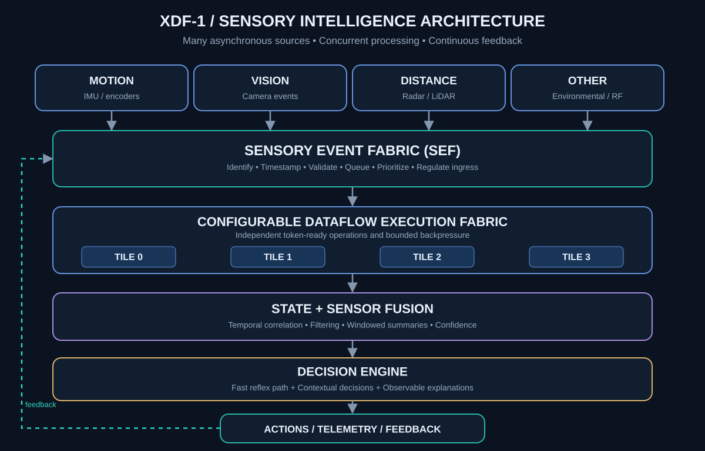
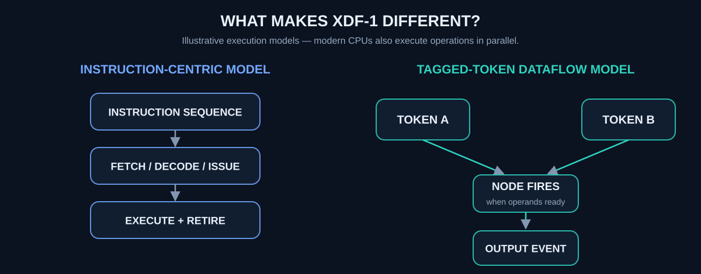

# XDF-1 — Event-Driven Sensory Computing Research Processor

**A research architecture for concurrent perception, stateful sensor fusion, and low-latency decisions.**

XDF-1 explores a question: **can a programmable, tagged-token dataflow fabric receive many independent sensory events, correlate them, maintain relevant state, and produce useful decisions with less coordination overhead than a conventional instruction-driven approach?**

The aspiration is not another general-purpose CPU. It is a **sensory computing fabric** where the arrival of data makes the necessary work eligible to execute. Fast, bounded reactions and richer contextual interpretations should be able to coexist without forcing unrelated signals to wait on each other.



> **Project philosophy:** sense concurrently; preserve event meaning and timing; compute when operands are ready; combine evidence over time; make explainable decisions; use feedback to improve the next observation.

## Two complementary execution paths


- **Fast reflex:** bounded dataflow rules and priorities for events with explicit response deadlines. A future safety-critical installation would require *separate, validated fail-safe protections*; XDF-1 is not yet such a safety controller.
- **Contextual decision:** combine timestamped observations, filtering, historical state, confidence/quality indicators, and programmable rules or future AI models. Report **what** decision was made and **why**.

Not every event must pass through every layer. Sensor rates can be very different: a high-bandwidth camera may require more resources than hundreds of low-rate sensors. We therefore measure **sustained events per second, burst capacity, per-event latency, bounded queue behavior, and energy per meaningful decision**, not sensor count alone.

## Why dataflow?



XDF-1 currently uses *tagged dataflow execution*: operations become eligible when their input ports have received matching tokens. The reference implementation uses a synchronous clock and a round-robin token router. A conventional CPU can also exploit parallelism; this illustration is a model comparison **not proof of a speed or power advantage**. Dataflow has extensive academic and commercial precedents; novel claims require demonstration against prior art.

## Technical foundation: implemented versus proposed

| Capability | Current status |
| --- | --- |
| Four synchronous 32-bit compute tiles | **Implemented and RTL-simulated** |
| Eight graph nodes per tile; 32 nodes total | **Implemented** |
| Two concurrent `(context, epoch)` tag slots | **Implemented and tested** |
| 64-bit token encoding; ready/valid router | **Implemented and tested** |
| ADD, SUB, XOR, AND, PASS, OUTPUT on acyclic graphs | **Implemented** |
| Python graph loader, reference model, automated tests | **Implemented** |
| Generic logic synthesis and machine-readable cell accounting | **Verified in GitHub Actions** |
| High-efficiency statically decoded operand storage | **Verified: 60.5% fewer generic cells for the four-tile core** |
| 4-lane/64-stream standalone sensory event ingress, priorities, state and fusion | **Python + RTL simulated; generic synthesis verified** |
| Source timestamps (carried, not synchronized), per-sensor sequence validation | **Implemented in sensory module** |
| Real deadline scheduling, integration with DAG compute tiles | **Not implemented** |
| Real sensor connectors, FPGA bitstream, operating system | **Not implemented** |
| Fabricated semiconductor / ASIC performance or power numbers | **Not implemented / not measured** |

### Measured first hardware optimization

Identical generic synthesis flows on GitHub Actions measured **90,085** leaf cells for the M1.1 baseline and **35,555** after replacing dynamic operand-register writes with statically decoded per-node writes: a **60.5% reduction in generic leaf cells** while maintaining 5,183 sequential cells. The optimized branch passed the existing 1,000-case RTL regression. These are **technology-independent Yosys cells**, not FPGA LUTs, ASIC area, measured power, or clock-frequency improvements; results can change with target mapping and synthesis settings.

The original M1.1 synthesis and RTL CI results are available in [`reports/M1_1_SYNTHESIS_GATE.md`](reports/M1_1_SYNTHESIS_GATE.md). Ongoing work is tracked in [`spec/architecture.md`](spec/architecture.md) and [`fpga/README.md`](fpga/README.md).

## First verified sensory prototype (standalone SEF)

The first **hardware-simulated Sensory Event Fabric** now ingests four physical
ready/valid lanes concurrently and distinguishes **64 logical sensor IDs**.
Its single-issue decision engine performs signed fixed-point smoothing,
latest-value four-sensor group fusion, per-sensor/group threshold decisions,
priority-aware arbitration with bounded low-priority service, and explicit
fault reporting for invalid or stale observations. It is **not connected to the
four-tile DAG processor yet**.

A deterministic Python-generated reference workload exercised **2,514
simulation cycles**, **1,887 accepted events**, **1,695 correct decisions**,
**192 rejected events**, and **625 cycles of held output under backpressure**.
Modelled accept-to-result latency under *this specific workload* averaged
**10.9 cycles**, with **44-cycle p99** and **57-cycle maximum**. These are
simulation cycles, **not physical nanoseconds** or guaranteed worst-case latency.

Generic Yosys synthesis (not FPGA device mapping) reports **36,345 leaf cells,
11,436 sequential** for the standalone 64-stream sensory block. Synthesis
includes strict checks for conflicting drivers and implausible state elimination.
See [`reports/M2_SEF_GATES.md`](reports/M2_SEF_GATES.md),
[`reports/OPTIMIZATION_EXPERIMENTS.md`](reports/OPTIMIZATION_EXPERIMENTS.md), and
[`spec/sensory-event-protocol.md`](spec/sensory-event-protocol.md).

```bash
# Verilator and a C++ toolchain required
make sensory-lint
make sensory-sim

# sv2v and Yosys required
make sensory-synth
```

## Phase 1 — Architecture optimization

1. Measure logic and latency against an unmodified, passing baseline.
2. Reduce costly operand storage and local scheduling while preserving token semantics.
3. Compare router buffering, arbitration, fairness and backpressure alternatives.
4. Parameterize and test smaller/larger compute fabrics with explicit resource limits.

## Phase 2 — Sensory intelligence and control

5. Define a **Sensory Event Fabric (SEF)** that accepts independent streams, timestamps events close to their sources, checks validity, and applies bounded admission control.
6. Support event priority and deadline metadata, plus **fair scheduling** to prevent background starvation.
7. Add predicates, comparisons, threshold triggers, and conditional routing for fast reflex logic.
8. Add explicit state, aggregation windows, deterministic ordering rules and feedback. Extend arithmetic with multiply-accumulate and saturating/fixed-point operations after numerical specification and cross-checking.

**First meaningful multi-sensor milestone:** simulate 64 logical streams with concurrent bursts, event reordering, output backpressure, and stateful fusion; demonstrate explainable decisions while checking event accounting and worst-case latency. Hardware interfaces and board-level measurements follow only when these contracts pass reference tests and RTL simulation.

### Timing and scientific accuracy

Femtosecond (`10^-15 s`) and zeptosecond (`10^-21 s`) interactions are *long-term physical research interests*, **not claims about digital sensor-to-decision latency**. We must measure capture, transport, queuing, computation, and actuation separately. Hardware physical limitations, clock rates, and sensor bandwidth determine practical response times.

## Run the existing M1 processor

Install Python 3.10+, PyYAML and pytest:

```bash
python3 -m pip install -e . pytest
make python-test
make reference
make vectors
```

The bundled graph computes `(A+B) XOR (C-D)` and returns **10** for `A=7, B=5, C=9, D=3`.

```bash
xdf1 programs/first_graph.yaml \
  --input A=7 --input B=5 --input C=9 --input D=3 \
  --context 1 --epoch 7 --emit build/run.json
```

For RTL verification, install Verilator and a C++ toolchain and run `make rtl-lint && make rtl-sim`.
For technology-independent synthesis, install `sv2v` and Yosys and run `make synth`. CI runs these stages separately, publishes synthesis evidence and rejects failures. The `build/` directory contains generated artifacts and is not checked into source control.

## Repository map

- [`rtl/`](rtl/) — SystemVerilog tiles, router, host interface and processor core.
- [`python/xdf1/`](python/xdf1/) — token definitions, graph validation, independent Python reference, host CLI and research models.
- [`tests/`](tests/), [`tb/`](tb/) — Python tests and SystemVerilog integration testbench.
- [`programs/`](programs/) — example computation graph.
- [`tools/`](tools/) — deterministic vectors, synthesis analysis and documentation utilities.
- [`spec/`](spec/) — execution contract, sensory event format, limitations and verification plan.
- [`docs/diagrams/`](docs/diagrams/) — editable, self-contained SVG architecture illustrations.
- [`fpga/`](fpga/), [`reports/`](reports/) — future FPGA acceptance criteria and measured evidence.

## What XDF-1 is not (yet)

XDF-1 is **not a CPU replacement, a fabricated chip, a safety-certified controller, a neuromorphic device, or an AI model**. The current hardware has no general memory access, arbitrary loops, untrusted-program isolation or physical sensory I/O. The architectural goal is to *test*, rather than assume, whether this style of computation improves latency, energy efficiency or predictable throughput on useful sensory workloads.

The project's source is available under the [MIT License](LICENSE). Contributions and reproducible comparative benchmarks are welcome.
